<div align="center">

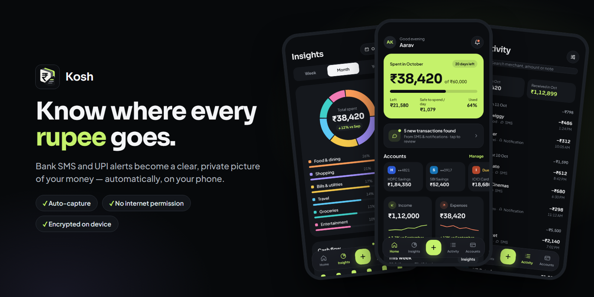


# Kosh

**A private personal-finance app for Android that tracks your money from bank SMS and UPI alerts, automatically and entirely on your phone.**

[](https://github.com/sreesayanth/kosh/raw/main/release/kosh-0.9.1.apk)


[](https://github.com/sreesayanth/kosh/actions/workflows/ci.yml)

[Download](#-download) · [Screenshots](#-screenshots) · [Features](#-features) · [Privacy](#-privacy-by-design) · [How it works](#-how-it-works) · [Build](#-build-from-source) · [Roadmap](#-roadmap)

</div>

---

## Why Kosh

Every payment you make in India already sends you a text: the bank SMS, the UPI alert, the card notification. Kosh reads those messages **on the device**, turns them into clean transactions (merchant, category, account, method), and builds budgets, insights and habits from them. You don't need to type anything, link a bank account or give a server your data.

The app has **no internet permission at all**. The build fails if any library tries to add one.

## 📥 Download

<table>
<tr>
<td width="60%">

### Kosh 0.9.1

| | |
|---|---|
| **File** | [`kosh-0.9.1.apk`](https://github.com/sreesayanth/kosh/raw/main/release/kosh-0.9.1.apk) |
| **Size** | 12.2 MB |
| **Requires** | Android 8.0 (API 26) or newer, ARM phone |
| **Package** | `com.impeesa.finance` |
| **SHA-256** | `A6EFCE345658C15F93B78D1A2F0922C3A0A9409171485A512A2BDCE9B9AAE90A` |

</td>
<td width="40%" align="center">

<a href="https://github.com/sreesayanth/kosh/raw/main/release/kosh-0.9.1.apk"></a>

<sub>Or browse the <a href="release/">release folder</a></sub>

</td>
</tr>
</table>

**Install**

1. Open the download link on your Android phone and save the APK.
2. Tap the file. When asked, allow **Install unknown apps** for your browser or file manager.
3. Open Kosh and follow onboarding. It explains exactly what is read before it asks for SMS access.

> [!IMPORTANT]
> **Android 13+:** apps installed outside an app store can be blocked from SMS access. If the permission is greyed out, open **Settings → Apps → Kosh → ⋮ → Allow restricted settings** and try again.

> [!NOTE]
> This build is a preview signed with a development key. A later build signed with the release key will need you to uninstall this one first, and uninstalling removes the app's local data. Backup and export are on the roadmap.

## 📱 Screenshots

<table>
<tr>
<td align="center">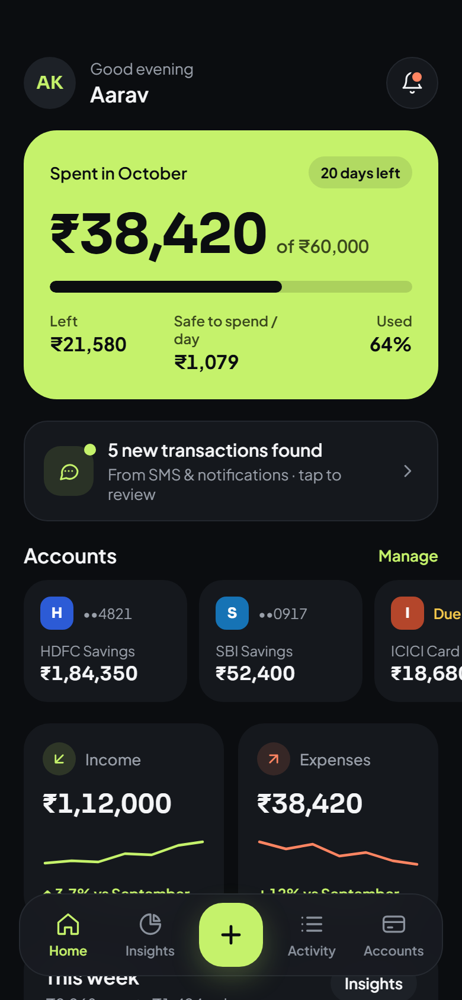<br><b>Home</b><br><sub>Monthly budget, accounts, weekly trend</sub></td>
<td align="center">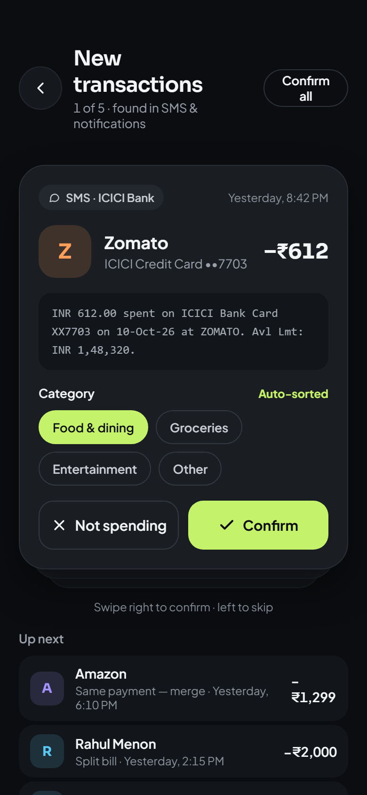<br><b>Review</b><br><sub>Confirm what the engine wasn't sure about</sub></td>
<td align="center">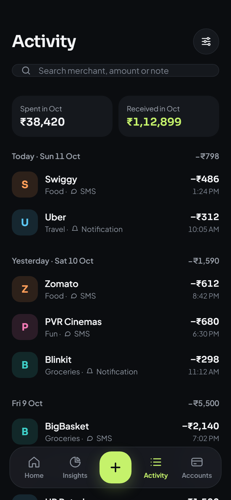<br><b>Activity</b><br><sub>Search, filters, day totals</sub></td>
<td align="center">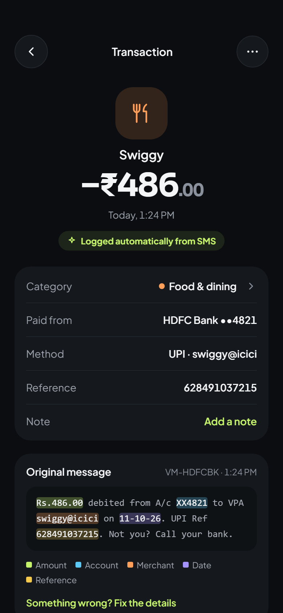<br><b>Detail</b><br><sub>The original message, with each extracted field highlighted</sub></td>
</tr>
<tr>
<td align="center">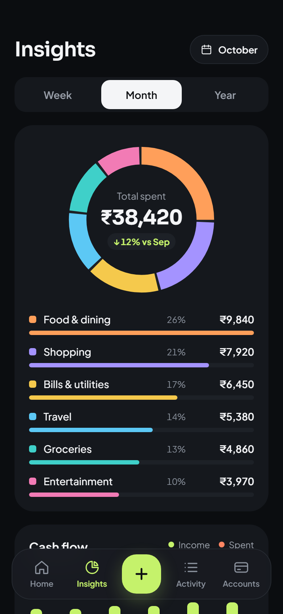<br><b>Insights</b><br><sub>Spending by category, cash flow</sub></td>
<td align="center">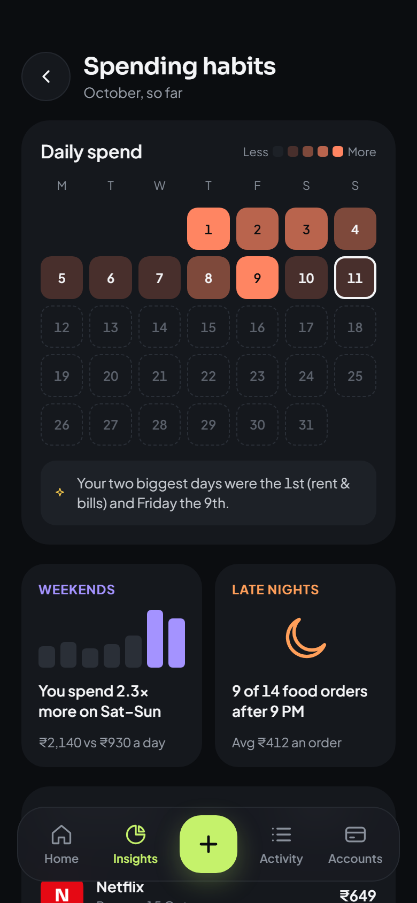<br><b>Habits</b><br><sub>Daily heatmap, subscriptions, top merchants</sub></td>
<td align="center">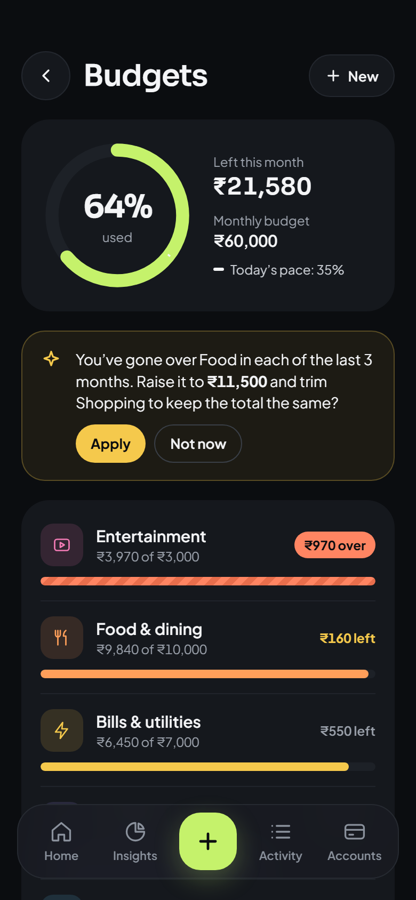<br><b>Budgets</b><br><sub>Per-category limits and pace</sub></td>
<td align="center">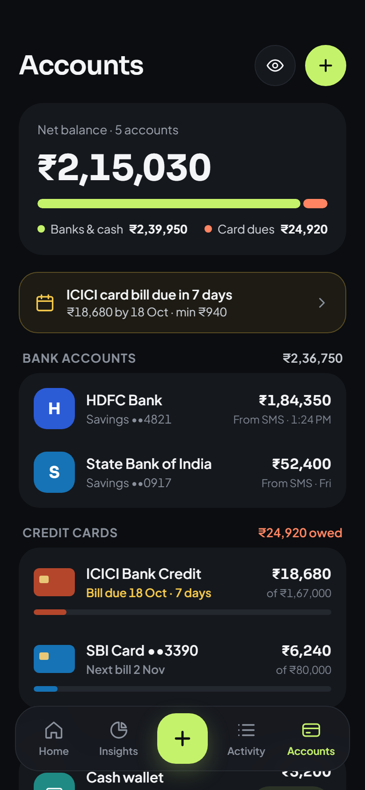<br><b>Accounts</b><br><sub>Banks, credit cards, wallets, cash</sub></td>
</tr>
<tr>
<td align="center">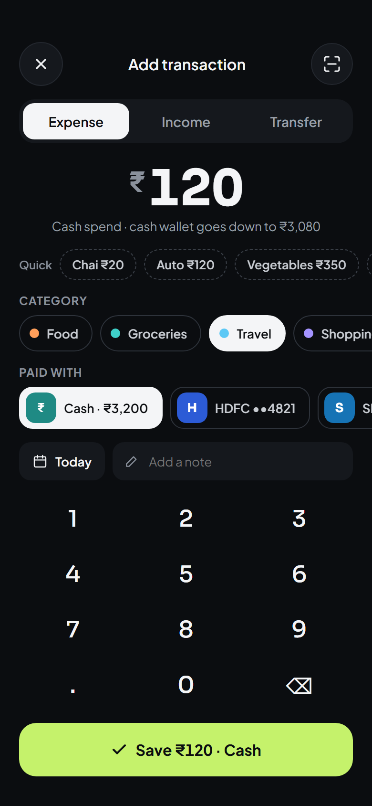<br><b>Add</b><br><sub>Fast manual entry for cash</sub></td>
<td align="center">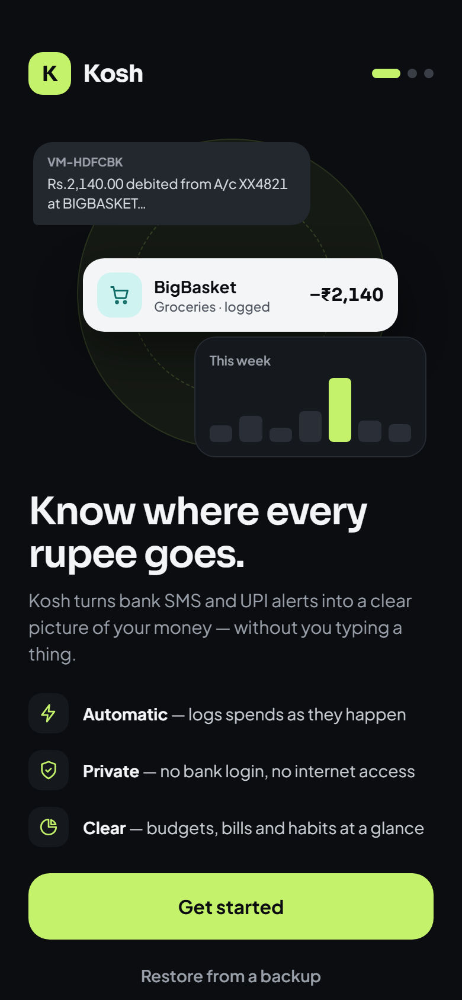<br><b>Welcome</b></td>
<td align="center">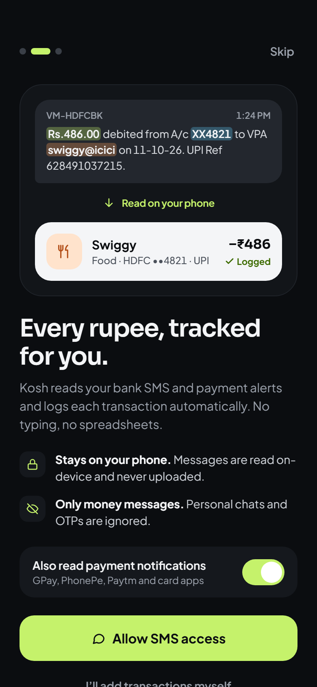<br><b>Onboarding</b><br><sub>Shows exactly what is read</sub></td>
<td align="center">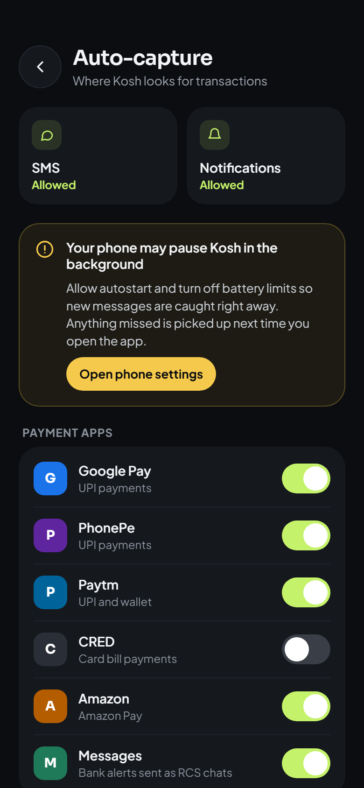<br><b>Auto-capture</b><br><sub>Sources, per-app switches, OEM tips</sub></td>
</tr>
</table>

<sub>Screens are taken from the <a href="https://claude.ai/artifact/7aztxLeB9VhLhyR1jpAfZ6">design canvas</a> (where the app's working name was "Kosh") and use sample data. The built app follows these designs; see the <a href="#-roadmap">roadmap</a> for what is done.</sub>

## ✨ Features

**Automatic capture**
- Reads bank, card and wallet **SMS** from 39 known Indian sender codes, live as messages arrive. On first run it can import the last 3, 6 or 12 months.
- Reads **payment-app notifications** from Google Pay, PhonePe, Paytm, CRED, Amazon Pay and others, but only from apps you switch on.
- **De-duplicates across sources.** When a bank SMS and a UPI app alert describe the same payment, they merge into one transaction: the SMS adds the account and reference, the app adds the clean merchant name.
- **Links related money movements:** card bill payments, transfers between your own accounts, wallet top-ups, ATM withdrawals (which move money into cash), refunds (which inherit the original purchase's category) and reversals (which cancel a failed debit).
- Ignores OTPs, promotions, collect requests and failed payments.
- Uncertain items go to a **Review queue** instead of being logged silently.

**Categories that learn**
- Correct a merchant twice the same way and Kosh sorts it that way from then on. Sort it two different ways and it asks you each time.
- One switch turns a correction into a rule ("Always sort Swiggy as Groceries"), and one tap applies it to earlier transactions. Rows you set by hand are never changed.
- Rules by merchant, UPI ID, message text, account or amount range can set a category, mark a transfer, leave a payment out of spending, or ask every time. Each rule shows how often it has matched.
- Every transaction says why it has its category: your choice, your rule, learned, a known merchant, or a keyword in the message.
- Add your own categories, recolour any, and archive your own (archiving asks where to move their transactions).

**Budgets, insights and habits**
- A monthly budget and per-category budgets, with a pace marker, a warn-at threshold and optional carry-over. Suggestions come from your last three months.
- **Safe to spend per day** on Home: what's left, minus bills Kosh expects before the period ends, divided by the days left.
- Your budget month can start on your salary day; Kosh spots the salary and suggests it.
- **Insights**: week, month or year donut by category, a like-for-like comparison ("↓ 12% vs last"), six periods of cash flow and your savings rate.
- **Habits**: a daily-spend calendar, weekday and weekend patterns, late-night food orders, top merchants, and subscriptions and bills found from repeating payments, with next dates and price changes.
- Short insights such as "Friday was 3× your usual day" use fixed templates with your numbers filled in. Nothing is generated, and you can dismiss any of them.

**Accounts, cards and alerts**
- Balances follow your bank. An "Avl Bal" in any SMS (or a card's available limit) becomes the balance, and Kosh keeps counting from there. When the two disagree, the bank wins and you're told about gaps over ₹500.
- Credit cards show what's owed, the available limit and utilisation with a 30 % marker. Bills are read from statement SMS (total, minimum, due date) or added by hand, and they're marked paid when the payment SMS arrives.
- Alerts, on separate notification channels: card bills 3 days before and on the due date (until paid), budget warnings, large payments, unusual days, subscription renewals and price changes, new accounts found, low balance (optional), balance updates, a weekly summary and auto-capture health. Every alert is shown once; the in-app list keeps 60 days.
- "Set balance" and "Count cash" for when you know better than the SMS.

**Money management**
- Multiple bank accounts, credit cards, wallets and a cash wallet, with net balance and card dues.
- Quick manual entry for cash, plus income and transfers.
- Activity with search, filters and day totals; edit, delete and undo.
- A simple on-device profile: set your name and avatar colour during onboarding, and change it any time from the avatar on Home.
- **Currency & format:** rupees with Indian grouping (₹1,84,350) by default, or pick from 12 currencies (US dollar, euro, pound, dirham, riyal and more) and Indian or international digit grouping. Amounts are shown in your choice, never converted.
- Quick access: long-press the icon for *Add spend*, *Review* or *Insights*, or add the *Add spend* Quick Settings tile.

**Detection engine**
- A pure-Kotlin rules engine: sender gatekeeping → message-type classification → amount, balance and limit selection → account mask, counterparty, date, reference and channel extraction → confidence scoring → routing (auto-log, review, info or drop).
- 18 bank and app templates and a dictionary of about 130 merchants.
- Every result is **explainable**: the Detail screen highlights which part of the message produced each field.

## 🔒 Privacy by design

| | |
|---|---|
| **No internet permission** | The app cannot send anything anywhere. A Gradle task, `verifyNoInternetPermission`, fails the build if a dependency adds network permissions. |
| **Encrypted storage** | Room on SQLCipher; the database key is wrapped by the Android Keystore. |
| **Minimal reading** | Only messages from known financial senders are parsed. Personal chats and OTPs are skipped and only counted. |
| **No accounts, no bank logins** | Nothing to sign up for and nothing to link. Your profile (name and colour) is stored only on the phone. |
| **Prominent disclosure** | Onboarding shows what is read and why, before any permission prompt. |
| **App lock** | PIN (stored as a salted PBKDF2 hash) plus fingerprint or face. It locks after 0, 1 or 5 minutes in the background, also covers notification taps, and backs off after wrong PINs. Forgot your PIN? Confirm with the phone's screen lock. |
| **Your backups, your key** | Backups are AES-256-GCM encrypted with your passphrase (PBKDF2, 600,000 rounds) and saved where you choose through the system file picker, Google Drive included, while Kosh itself stays offline. Weekly backups keep the last 4. Android's cloud backup is off. |
| **Retention and delete-all** | Message texts are kept 30/90/180 days, forever or not at all. *Delete all data* (type DELETE, then confirm with your screen lock) removes the database, its key and every setting. |

## ⚙️ How it works

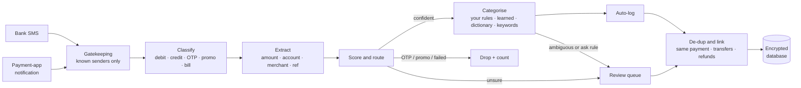

All writes go through a single ingestion queue, so a message arriving twice (live receiver plus catch-up scan, say) is stored only once.

## 🏗️ Architecture

Native Android in **Kotlin + Jetpack Compose**, split into modules so the detection engine stays pure and testable on the JVM.

| Module | Responsibility |
|---|---|
| `app` | Activity, type-safe navigation, manual DI (`AppContainer`), feature screens, SMS receiver, notification listener, WorkManager jobs |
| `core:model` | Pure Kotlin types: `Money` (paise), `MoneyFormat` (₹ with Indian grouping), `DateKey`, account and category models |
| `core:engine` | Pure Kotlin detection engine with templates, sender and merchant dictionaries, and corpus evaluation |
| `core:data` | Room on SQLCipher, repositories, capture and de-duplication, migrations |
| `core:ui` | Design tokens, Sora and Plus Jakarta Sans fonts (OFL), shared components and icons |

**Stack:** Kotlin 2.1 · Compose BOM 2024.12 · Navigation 2.8 · Room 2.6 · SQLCipher 4.6 · Paging 3 · WorkManager 2.10 · kotlinx-serialization · minSdk 26, targetSdk 35.

## 🛠️ Build from source

Requirements: **JDK 17** and the **Android SDK** (platform 35, build-tools 35).

```bash
git clone https://github.com/sreesayanth/kosh.git
cd kosh

./gradlew :core:model:test :core:engine:test testDebugUnitTest   # unit tests
./gradlew assembleDebug                                           # build the APK
./gradlew :app:verifyNoInternetPermission                         # privacy check
./gradlew connectedDebugAndroidTest                               # device tests (needs a phone or emulator)
```

The debug APK is written to `app/build/outputs/apk/debug/`.

## 🎯 Engine accuracy

`./gradlew :core:engine:evaluate` prints a report over a corpus of **929 messages** (174 hand-written seeds plus value variants). The build fails if:

- auto-log precision falls below **99.5%**, or recall below **95%**
- any amount is extracted wrong
- anything that must be ignored (OTP, promotion, collect request, failed payment) gets captured

The corpus is synthetic, written from known Indian bank formats, so its 100% score measures consistency, not real-world accuracy. Two batches of formats the engine had never seen scored as follows before they were fixed:

| Unseen batch | Precision | Recall | Merchant naming |
|---|---|---|---|
| Batch 1 | 100% | 90% | 62.5% |
| Batch 2 | 91.7% | 100% | 50% |

Both batches are now part of the corpus. To contribute real formats safely, anonymise them first with `./gradlew :core:engine:anonymize -Pin=raw.tsv -Pout=new.jsonl`, then add the output to `core/engine/src/test/resources/corpus-holdout/`.

## 🗺️ Roadmap

- [x] **Phase 0:** project setup, design system, encrypted database, navigation shell
- [x] **Phase 1:** manual tracking with accounts (bank, card, wallet, cash), add/edit/delete with undo, transfers, Activity, Detail, Home
- [x] **Phase 2:** detection engine, 18 templates, merchant dictionary, confidence routing, golden corpus with accuracy gates
- [x] **Phase 3:** SMS capture with onboarding, live receiver, history import, catch-up, de-duplication, Review queue, notifications
- [x] **Phase 4:** payment-app notifications, cross-source merge and split, transfer, refund and reversal linking, Auto-capture screen
- [x] **Phase 5:** categorisation that learns from corrections, rules (merchant, UPI ID, text, account, amount), apply to history, categories editor, Settings
- [x] **Phase 6:** budgets (salary-cycle months, carry-over, suggestions, rebalance), Insights, Habits, charts, recurring and salary detection, insight rules
- [x] **Phase 7:** balance snapshots and reconciliation, account and card detail, statements from SMS, auto-mark paid, alerts engine with 11 alert types, Alerts screen and settings
- [x] **Phase 8:** app lock with fingerprint, hide balances, recents protection, encrypted backup and restore, weekly backup, CSV and PDF export, message retention, delete all data, privacy page
- [x] **Phase 9 (first pass):** currency settings, swipe-to-review with haptics, Remove-animations support, 48 dp touch targets, TalkBack headings and merged rows, larger-text layouts, app shortcuts and Quick Settings tile, database-recovery screen
- [ ] **Phase 9 (needs a device):** baseline profile and benchmarks, screenshot tests at 200 % text, corpus to 1,500+ messages
- [ ] **Phase 10:** release signing and Play Store

The full plan, including the technology decisions, data model, security and testing strategy, is in **[IMPLEMENTATION_PLAN.md](IMPLEMENTATION_PLAN.md)**.

## 📚 Project links

- 📐 [Implementation plan](IMPLEMENTATION_PLAN.md)
- 🎨 [Design canvas](https://claude.ai/artifact/7aztxLeB9VhLhyR1jpAfZ6): all 23 screens
- 📦 [Release APKs](release/)

<div align="center">
<sub>Made in India 🇮🇳 for people who want to know where their money goes, without giving it away.</sub>
</div>
